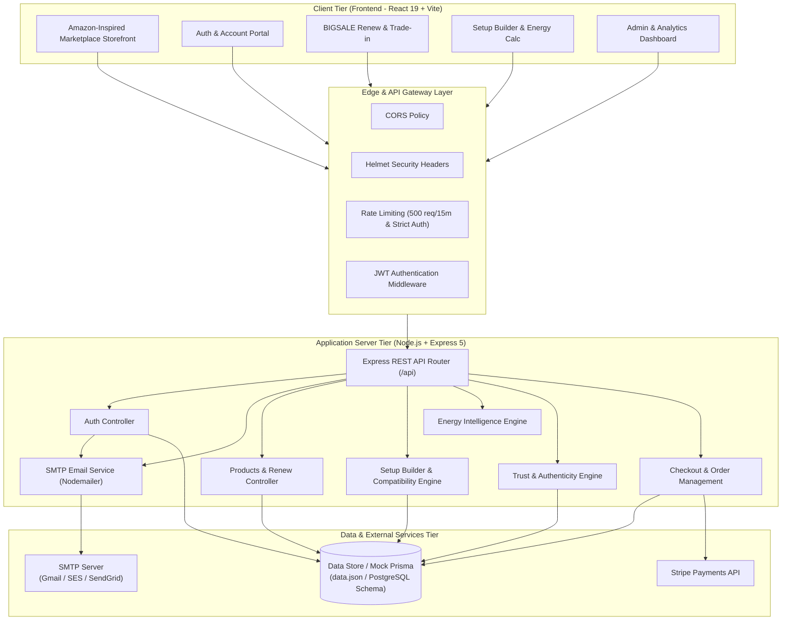
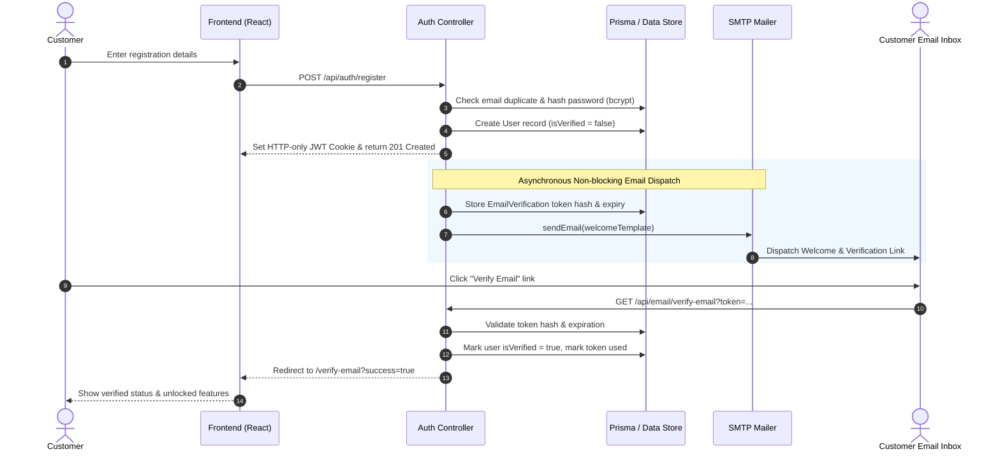
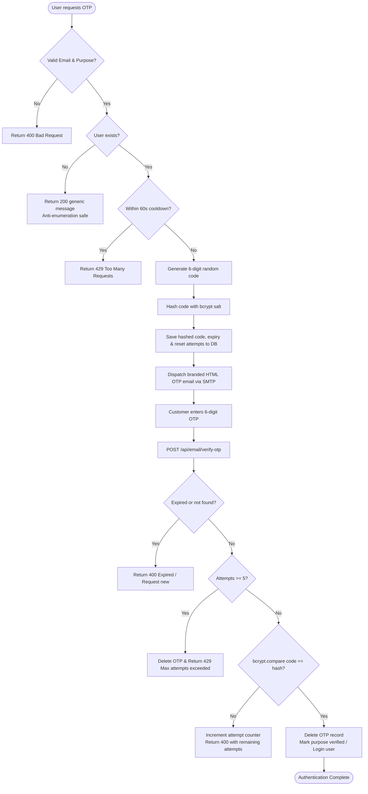
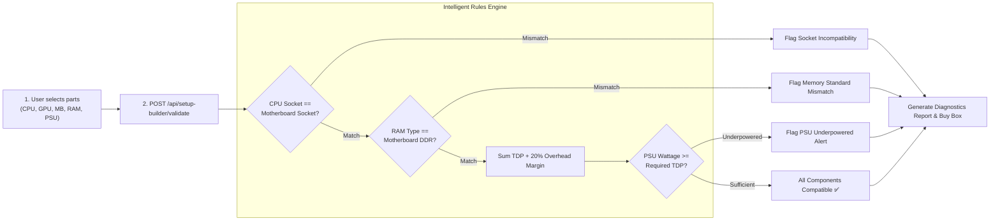

# 🛍️ BIGSALE - Global Electronics & Electricals Marketplace

[](https://nodejs.org)
[](https://www.typescriptlang.org/)
[](https://react.dev/)
[](https://tailwindcss.com/)
[](https://www.postgresql.org/)
[](https://www.docker.com/)

**BIGSALE** is a full-featured, enterprise-grade e-commerce marketplace platform engineered for global electronics and electricals. It features an Amazon-inspired premium shopping experience, AI-assisted product discovery, comprehensive refurbished electronics workflows, and a production-grade SMTP email communication service.

---

## 🚀 Key Feature Highlights

### 1. ♻️ BIGSALE Renew (Refurbished & Trade-in Marketplace)
- Dedicated refurbished electronics hub (smartphones, laptops, desktops, audio, accessories).
- Standardized condition grading (Grade A: Pristine, Grade B: Good, Grade C: Fair).
- Verified battery health metrics, multi-point inspection checklists, and warranty exclusions.
- Multi-step customer trade-in calculator with estimated trade-in credit generation.

### 2. 🔍 AI Visual & Barcode Search
- Direct image upload and live camera scanning for visual product discovery.
- Barcode and QR code instant lookup.
- Integrated camera capture mode with smart fallback matching.

### 3. 🖥️ Intelligent PC Setup Builder
- Component-by-component rig builder (CPU, GPU, Motherboard, RAM, Storage, PSU, Cooler, Case).
- Live power consumption calculation and bottleneck analysis.
- Socket, form-factor, and wattage compatibility validation before purchase.

### 4. ⚡ Energy Intelligence Calculator
- Real-time electricity consumption and operating cost estimator.
- Regional tariff presets (kWh pricing) with custom tariff sliders.
- Daily, monthly, and yearly cost projections with eco-efficiency badges.

### 5. 🛡️ Trust Centre & Authenticity Verification
- Serial number and IMEI verification portal.
- Tamper-proof digital authenticity certificates with cryptographic seals.
- Authorised dealer directory and anti-counterfeit reporting.

### 6. 📧 Production SMTP Email Service
- Reusable TypeScript mailer singleton with connection verification and safe fallback handling.
- Professional, mobile-responsive HTML templates (Welcome, Verification, OTP, Password Reset, Admin Notifications).
- Cryptographically secure 6-digit OTPs with bcrypt hashing, attempt limits, and resend cooldowns.
- Single-use, time-limited tokenized email verification and password reset flows.
- Strict per-IP rate limiting on auth and notification endpoints.

---

## 🏛️ Platform Architecture & Block Diagrams

### 1. High-Level System Architecture Diagram



---

## 🔄 Core Workflows & Flowcharts

### 1. Customer Authentication & Email Verification Flow



### 2. Multi-Factor OTP Verification Lifecycle



### 3. PC Setup Builder Compatibility & Power Flow



---

## 🎨 Design System & Theme

BIGSALE features a conversion-focused Amazon-inspired marketplace theme:
- **Midnight Navy (`#0F1B2D`) & Deep Navy (`#152A45`)**: Header, brand navigation, and top banners.
- **Marketplace Orange (`#FF9900`)**: Primary actions, search triggers, offers, and Badges.
- **Bright Yellow (`#FFD814`)**: Promotional CTAs and instant "Add to Cart" / "Buy Now" buttons.
- **Light Background (`#F3F5F8`)**: High-contrast, clean marketplace background.
- **Main Text (`#172337`) & Muted Text (`#667085`)**: Optimized legibility and contrast.

---

## 🛠️ Tech Stack

### Frontend Architecture
- **Framework**: React 19 + TypeScript + Vite
- **Styling**: Tailwind CSS + Custom CSS Theme Variables
- **State Management**: Zustand
- **Data Fetching & Cache**: TanStack React Query v5
- **Icons & Animation**: Lucide React + Framer Motion
- **Forms & Validation**: React Hook Form + Zod
- **Notifications**: React Hot Toast

### Backend Architecture
- **Runtime & Server**: Node.js v24 + Express.js 5 + TypeScript
- **Data Layer**: Mock Prisma Client (JSON file-backed database) with PostgreSQL compatibility
- **Email Service**: Nodemailer (SMTP with connection verification & templating)
- **Security**: JWT Authentication, Bcrypt Hashing, Helmet Headers, Express Rate Limit, Cookie Parser
- **Logging**: Morgan + Winston

---

## ⚙️ SMTP Email Configuration

The backend supports any standard SMTP provider (Gmail, SendGrid, Amazon SES, Mailgun, Mailtrap, MailHog).

Add these parameters to your `backend/.env`:

```env
# SMTP Email Configuration
SMTP_HOST=smtp.gmail.com
SMTP_PORT=587
SMTP_SECURE=false
SMTP_USER=your-email@gmail.com
SMTP_PASS=your-app-password
SMTP_FROM="BIGSALE <your-email@gmail.com>"
FRONTEND_URL=http://localhost:5173

# Security & Expiration Settings
EMAIL_VERIFICATION_EXPIRES_HOURS=24
OTP_EXPIRES_MINUTES=10
OTP_MAX_ATTEMPTS=5
OTP_RESEND_COOLDOWN_SECONDS=60
PASSWORD_RESET_EXPIRES_HOURS=1
```

> **Note**: When `SMTP_USER` or `SMTP_PASS` are unset or using placeholder values, the server operates in safe simulated mode, logging email dispatches to the console without throwing errors.

---

## 💻 Quick Start & Running Locally

### 1. Prerequisites
- **Node.js**: `v18+` (Recommended: `v22+` or `v24`)
- **npm**: `v9+`

### 2. Backend Setup
```bash
cd backend

# Install dependencies
npm install

# Copy environment file
cp .env.example .env

# Run development server (watch mode)
npm run dev
```
Backend runs on `http://localhost:4000` (Healthcheck: `http://localhost:4000/api/health`).

### 3. Frontend Setup
In a new terminal:
```bash
cd frontend

# Install dependencies
npm install

# Run Vite dev server
npm run dev
```
Frontend runs on `http://localhost:5173`.

---

## 📚 API Endpoints Summary

| Category | Method | Endpoint | Auth Required | Description |
| :--- | :--- | :--- | :--- | :--- |
| **System** | `GET` | `/api/health` | No | System health check & uptime |
| **Auth** | `POST` | `/api/auth/register` | No | Register account & auto-send welcome email |
| **Auth** | `POST` | `/api/auth/login` | No | Authenticate user & get JWT |
| **Auth** | `GET` | `/api/auth/me` | Yes | Get authenticated profile |
| **Email** | `POST` | `/api/email/send-otp` | No (Rate Limited) | Generate & email 6-digit hashed OTP |
| **Email** | `POST` | `/api/email/verify-otp` | No (Rate Limited) | Verify OTP with max attempt throttling |
| **Email** | `POST` | `/api/email/forgot-password` | No (Rate Limited) | Dispatch single-use password reset link |
| **Email** | `POST` | `/api/email/reset-password` | No (Rate Limited) | Validate reset token & update password |
| **Email** | `GET` | `/api/email/verify-email` | No | Confirm email address via link |
| **Email** | `POST` | `/api/email/resend-verification`| Yes | Resend verification link |
| **Email (Admin)**| `POST` | `/api/email/test` | Admin | Send test email to target address |
| **Email (Admin)**| `POST` | `/api/email/verify-connection`| Admin | Check live SMTP handshake status |
| **Renew** | `GET` | `/api/renew/products` | No | List certified renewed devices |
| **Renew** | `POST` | `/api/renew/trade-in` | No / Yes | Submit device for trade-in valuation |
| **Setup Builder**| `GET`| `/api/setup-builder/components`| No | List PC components & specifications |
| **Setup Builder**| `POST`| `/api/setup-builder/validate`| No | Check compatibility & power requirements |
| **Energy** | `POST` | `/api/energy/calculate` | No | Calculate electricity cost estimates |
| **Trust** | `GET` | `/api/trust/verify/:serial` | No | Verify product authenticity & certificate |
| **Products** | `GET` | `/api/products` | No | Search, filter, and paginate catalog |
| **Cart** | `GET/POST`| `/api/cart` | Yes | View and modify customer cart |
| **Checkout** | `POST` | `/api/checkout/place-order`| Yes | Complete order & transit protection |

---

## 🔑 Trial Credentials

| Role | Email | Password | Permissions |
| :--- | :--- | :--- | :--- |
| **Administrator** | `admin@bigsale.com` | `Admin123!` | Admin Dashboard, SMTP Management, Order & Product Controls |
| **Customer** | `customer@bigsale.com` | `Customer123!` | Storefront browsing, Cart, Trade-in, Wishlist, Setup Builder |

---

## 📄 License
This project is licensed under the MIT License.
